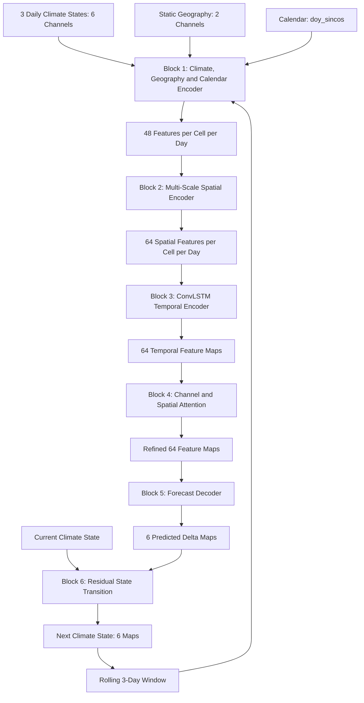

# Multiverse of Monsoon — Proposed Model Architecture

## Overview
Our proposed model forecasts the next climate state over India's 32 × 36 grid using the previous three daily climate states. It combines climate input encoding, spatial learning, temporal learning, attention-based refinement, and a forecast decoder.

The model predicts one next-day state at a time. For a 10-day forecast, each predicted state is fed back into the model as part of the rolling input window.

> **Architecture status:** This is a proposed design. The blocks, dimensions, and choices below must be implemented, trained, and validated. They are not supplied pretrained weights or a guaranteed optimal architecture.

## 1. Input Data

### Dynamic climate variables — 6 channels

| Channel | Variable | Unit |
|---|---|---|
| 1 | `t2m` — temperature at 2 metres | K |
| 2 | `tp` — precipitation | mm/day |
| 3 | `u10` — east-west wind component | m/s |
| 4 | `v10` — north-south wind component | m/s |
| 5 | `msl` — mean sea-level pressure | Pa |
| 6 | `tcwv` — total column water vapour | kg/m² |

### Static geographic variables — 2 channels
- `land_sea_mask`
- `orography_m` — elevation

### Calendar input
- `doy_sincos`: 2 values representing annual-cycle position of the last input day.
- These are transformed into learned features and broadcast across the grid.

### Input window
- Three consecutive daily states.
- Grid: `32 × 36`.
- Dynamic input: `3 × 6 × 32 × 36`.
- Static geography: `2 × 32 × 36`.
- Calendar: 2 values.

## 2. Block 1 — Climate Input Encoder

**Purpose:** Transform raw climate variables, geography, and calendar context into learned feature representations.

- **Climate projection:** `1 × 1` convolution, 6 → 32 channels. Combines climate variables at each grid cell; does not directly examine neighbours.
- **Geographic projection:** 2 static channels → 8 learned channels.
- **Calendar projection:** 2 `doy_sincos` values → 8 learned values, broadcast across the `32 × 36` grid.
- **Concatenation:** 32 climate + 8 geography + 8 calendar = 48 channels per cell per day.

**Output:** `3 × 48 × 32 × 36` (sequence preserved).

## 3. Block 2 — Multi-Scale Spatial Encoder

**Purpose:** Learn spatial relationships among neighbouring cells and patterns at different scales. Processes each day's 48-channel representation.

| Branch | Operation | Channels | Configuration |
|---|---|---|---|
| A | 3 × 3 convolution | 48 → 16 | Padding 1, stride 1 |
| B | 5 × 5 convolution | 48 → 16 | Padding 2, stride 1 |
| C | Dilated 3 × 3 convolution | 48 → 16 | Dilation 2, padding 2, stride 1 |

Each branch outputs `16 × 32 × 36`.

**Fusion:**
1. Concatenate branches: 16 + 16 + 16 = 48 channels.
2. `1 × 1` convolution: 48 → 64.
3. Activation (e.g., ReLU).
4. Optionally add a residual refinement block, if validation supports it.

**Output:** `3 × 64 × 32 × 36` (sequence preserved).

## 4. Block 3 — Temporal Dynamics Encoder (ConvLSTM)

**Purpose:** Learn how spatial climate patterns evolve across the three input days.

- Input sequence: `3 × 64 × 32 × 36`.
- ConvLSTM hidden channels: 64.
- Kernel: `3 × 3`, padding 1.
- Sequence length: 3.

The ConvLSTM processes the daily feature maps sequentially, carrying a spatially structured memory forward:
1. Day 1 establishes an initial memory.
2. Day 2 is processed with the features and memory from Day 1.
3. Day 3 is processed with the features and updated memory from previous days.

**Output:** Final hidden representation `64 × 32 × 36`.

## 5. Block 4 — Spatial Context Module (Attention)

**Purpose:** Reweight feature channels and grid locations to emphasize information useful for forecasting. This is a lightweight, CBAM-inspired design, not a large Transformer.

### Channel attention
1. Global average pooling over the grid.
2. Global max pooling over the grid.
3. Shared bottleneck MLP: `64 → 16 → 64`.
4. ReLU and sigmoid.
5. Produce 64 channel weights and reweight the feature channels.

### Spatial attention
1. Average and max across channels.
2. Concatenate the two summaries.
3. `7 × 7` convolution, padding 3.
4. Sigmoid to produce a `32 × 36` spatial attention map.
5. Reweight the representation spatially.

**Output:** `64 × 32 × 36`. Dimensions are preserved.

## 6. Block 5 — Forecast Decoder

**Purpose:** Transform the refined representation into six climate-variable prediction maps.

| Layer | Configuration |
|---|---|
| Convolution 1 | 3 × 3, 64 → 64, padding 1 |
| Activation | ReLU |
| Convolution 2 | 3 × 3, 64 → 32, padding 1 |
| Activation | ReLU |
| Convolution 3 | 1 × 1, 32 → 6 |

Output channels correspond to:
1. `t2m`
2. `tp`
3. `u10`
4. `v10`
5. `msl`
6. `tcwv`

Each output is a `32 × 36` map. In the proposed residual approach, these are **predicted change/delta maps**, not the complete next state.

**Output:** `6 × 32 × 36`.

If normalization is used, residual addition must be consistent in normalized space or through a proper conversion. Never directly add a normalized delta to an unnormalized physical value.

## 7. Block 6 — Residual State Transition

**Status:** Implemented (`monsoon_r1.models.residual_state_transition.ResidualStateTransition`) & Verified (71/71 tests passing).

**Purpose:** Combine the predicted changes (deltas from Block 5) with the current state to produce the next climate state.

- Take the current climate state `[B, 6, 32, 36]`.
- Take the predicted climate deltas `[B, 6, 32, 36]` from Block 5.
- Apply the residual transition: `next_state = current_state + delta`.
- Optionally apply channel standard deviation scales $\sigma$ (`channel_scales`) when deltas are normalized.
- Return the next climate state `[B, 6, 32, 36]`.

**Physical considerations:**
- Enforces non-negative precipitation ($tp \ge 0$) on channel 1 without modifying other channels.
- Zero precipitation with zero delta remains zero ($0 + 0 = 0$).
- Positive precipitation is preserved without arbitrary distortion.
- Fully differentiable out-of-place assembly preserves autograd graphs through all 6 blocks.
- Supports physical perturbations via `apply_perturbation(initial_state, perturbation)`.

**Output:** `[B, 6, 32, 36]`.

## 8. Autoregressive 10-Day Rollout

The model predicts one day at a time using a rolling three-day input window.

| Prediction | Input window | Predicted output |
|---|---|---|
| Step 1 | Day 1, Day 2, Day 3 | Day 4 |
| Step 2 | Day 2, Day 3, Day 4 | Day 5 |
| Step 3 | Day 3, Day 4, Day 5 | Day 6 |
| Step 4 | Day 4, Day 5, Day 6 | Day 7 |
| … | … | … |
| Step 10 | Latest three states | Day 13 (10 steps beyond Day 3) |

At each step:
1. Use the latest three states.
2. Run Blocks 1–5.
3. Apply Block 6.
4. Shift the window forward.
5. Repeat.

**Rollout output:** `10 × 6 × 32 × 36`.

## 9. Multiverse / Perturbation Simulation

The same trained model is used for a baseline timeline and a perturbed timeline.

### Timeline Prime
- Start with the original initial state.
- Generate the forecast rollout.

### Alternate Timeline
- Apply the supplied perturbation to the last initial state, as specified by the simulation contract.
- Use the modified state in the initial input window.
- Run the same model and rollout.

Compare the rollouts to study how the perturbation affects climate evolution. The model must not hardcode responses to specific perturbations; effects should emerge from its learned dynamics.

## 10. Architecture Flow

## 11. Model Dimensions Summary

| Stage | Shape |
|---|---|
| Dynamic input | `3 × 6 × 32 × 36` |
| Static geography | `2 × 32 × 36` |
| Calendar | `2` |
| Block 1 | `3 × 48 × 32 × 36` |
| Block 2 | `3 × 64 × 32 × 36` |
| Block 3 | `64 × 32 × 36` |
| Block 4 | `64 × 32 × 36` |
| Block 5 | `6 × 32 × 36` |
| Block 6 | `6 × 32 × 36` |
| 10-step rollout | `10 × 6 × 32 × 36` |

## 12. Training and Validation — To Be Implemented

The architecture alone does not learn to forecast. The training pipeline must:
- Load historical climate data.
- Use chronological train/validation splits.
- Create sliding three-day input windows and next-day targets.
- Apply channel-specific normalization using supplied or training-derived statistics.
- Train the model to predict next-day states or residual changes consistently with the residual design.
- Evaluate on held-out chronological periods.
- Measure multi-step rollout stability, not just one-step accuracy.
- Evaluate precipitation and extreme rainfall.
- Test perturbation response.
- Compare against simple baselines, including repeat-yesterday persistence.

**This architecture is a proposal, not a demonstrated result.** Training, validation, stability, perturbation behaviour, and runtime must be measured.

## 13. Implementation Priorities

1. Build and validate the input pipeline and Block 1.
2. Implement Block 2 and verify tensor shapes.
3. Establish a simple decoder and residual-transition baseline.
4. Add ConvLSTM temporal learning.
5. Add attention only if it improves measured performance.
6. Train and evaluate autoregressive rollouts.
7. Test perturbation handling and API compliance.
8. Optimize CPU inference for the offline environment.

A smaller, stable, validated model is preferable to a complex model that cannot be trained, tested, or run within evaluation constraints.

## Final Summary

The proposed architecture transforms climate data into learned representations, learns spatial relationships and temporal evolution, refines the representations with attention, decodes them into six predicted changes, and combines those changes with the current climate state to generate the next state. Feeding predictions back into a rolling window enables multi-day forecasting. The same model can simulate alternate timelines by applying an initial perturbation and comparing the resulting rollout with the baseline.
